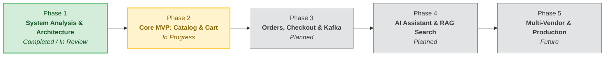

# Development Roadmap

## 1. Overview

This roadmap defines the engineering milestones, implementation phases, and deliverables for the **AI Tech Marketplace** project across its multi-repository ecosystem.

---

## 2. High-Level Phases

---

## 3. Detailed Phase Breakdown

### Phase 1 — System Analysis & Architecture
**Status:** Completed / In Review  
**Focus:** Establishing architecture foundations, data modeling, and engineering standards.

- [x] Product requirement specification & target tech categories (`requirements/requirements.md`)
- [x] Business rules catalog for users, products, cart, order, and AI (`requirements/business-rules.md`)
- [x] Comprehensive use cases covering Customer, Seller, Admin, and AI actors (`requirements/use-cases.md`)
- [x] Architecture Decision Records (ADR-001 through ADR-012)
- [x] Database schema design with PostgreSQL and Flyway migration planning (`database/schema.md`, `database/migrations.md`)
- [x] C4 System Context & Container diagrams (`diagrams/system-context.md`, `diagrams/container-diagram.md`)
- [x] End-to-end Sequence diagrams for Auth, Checkout, and AI chat (`diagrams/sequence-diagrams.md`)
- [x] Conceptual Entity Relationship Diagram (`diagrams/erd.md`)
- [x] API contracts for Auth, Products, Cart, Orders, and AI (`api/`)

---

### Phase 2 — Core MVP: Catalog & Shopping Cart
**Status:** In Progress  
**Focus:** Implementing the foundational Spring Boot backend and React web client.

#### Backend (`ai-tech-marketplace-backend`):
- [x] Project initialization with Java 21, Spring Boot 3.4, and PostgreSQL Docker setup.
- [x] Flyway migrations `V1__init.sql` through `V6__create_carts.sql`.
- [x] JWT Authentication & User management (Register, Login, Token generation, Password hashing).
- [x] Categories & Brands management APIs (`GET /api/v1/categories`, `GET /api/v1/brands`).
- [x] Product catalog management (`GET /api/v1/products`, `GET /api/v1/products/{id}`).
- [x] Product gallery image management (`/api/v1/admin/products/{id}/images`).
- [x] Shopping Cart implementation (`/api/v1/cart`, add/update/remove items, ownership check, stock limits).
- [ ] Redis caching for frequently accessed products and category trees.

#### Frontend (`ai-tech-marketplace-frontend`):
- [ ] React 19 + TypeScript + Tailwind CSS project scaffolding.
- [ ] Authentication views (Login, Registration, Protected route wrappers).
- [ ] Product discovery views (Catalog grid, Search input, Category & Brand filter sidebar, Pagination).
- [ ] Product detail page (Image gallery, Specs display, Stock status indicator, Add-to-cart button).
- [ ] Shopping cart drawer / view (Quantity adjustments, Subtotal calculations).

---

### Phase 3 — Orders, Checkout & Event Streaming
**Status:** Planned  
**Focus:** Complete transactional checkout, inventory consistency, and asynchronous domain events.

- [ ] Shipping address management APIs (`/api/v1/addresses`).
- [ ] Transactional checkout pipeline (`POST /api/v1/orders`):
  - Cart item snapshotting into immutable order items.
  - Inventory quantity reservation with concurrency protection.
  - Active cart clearing upon successful checkout.
- [ ] Order lifecycle management (Pending → Confirmed → Processing → Shipped → Delivered / Cancelled).
- [ ] Redis distributed locking for high-concurrency checkout race conditions.
- [ ] Apache Kafka integration:
  - Event publishing: `OrderCreated`, `OrderConfirmed`, `OrderCancelled`, `InventoryReserved`, `InventoryReleased`.
  - Asynchronous background consumers for transactional email notifications.
  - Mock payment gateway integration (webhook callbacks).
- [ ] Promotion & Coupon System:
  - Flyway migration `V13__create_coupons.sql` (`coupons` with `is_public`, `coupon_usages` with `status` and `released_at`).
  - Customer coupon discovery API (`GET /api/v1/coupons`).
  - Pre-checkout validation API (`POST /api/v1/coupons/validate`) with dynamic shipping fee resolution.
  - Transactional checkout redemption with quota management and audit recording.
  - Automated coupon quota rollback on order cancellation / 15-minute unpaid timeout (`BR-COUPON-007`).
  - Administrative coupon management endpoints (`/api/v1/admin/coupons`).

---

### Phase 4 — AI Shopping Assistant & Semantic Search
**Status:** Planned  
**Focus:** Integrating the Python FastAPI AI service with RAG and LLM recommendations.

- [ ] Python FastAPI service scaffolding (`ai-tech-marketplace-ai`).
- [ ] Product catalog ingestion and vectorization:
  - Text chunking for product specifications, features, and use cases.
  - Embedding generation using external LLM APIs (Gemini / OpenAI).
  - Vector indexing (PostgreSQL `pgvector` or dedicated vector store).
- [ ] RAG Pipeline implementation:
  - User query intent recognition (budget, primary use case, required specifications).
  - Semantic vector search + metadata pre-filtering.
  - Grounded context prompt assembly (anti-hallucination guardrails).
  - LLM response generation with product suggestions and rationale.
- [ ] Internal API communication between Spring Boot backend and FastAPI service.
- [ ] React floating AI Chat Assistant widget with streaming responses and clickable product recommendations.

---

### Phase 5 — Multi-Vendor Operations, Analytics & Production Readiness
**Status:** Future  
**Focus:** Scaling platform governance, seller operations, monitoring, and cloud deployment.

- [ ] Seller portal UI & permissions:
  - Product submission and pricing management.
  - Inventory restocking.
  - Seller-specific order fulfillment tracking.
- [ ] Administrative analytics dashboard (GMV, sales volume, top categories, conversion metrics).
- [ ] Infrastructure & DevOps (`ai-tech-marketplace-infra`):
  - Production Docker Compose & Kubernetes Helm charts.
  - GitHub Actions CI/CD pipelines for automated testing, linting, and container builds.
  - Centralized logging and metrics (Prometheus, Grafana, OpenTelemetry).
  - API rate limiting and security hardening (WAF, CORS, CSP headers).

---

## 4. Milestone Summary

| Milestone | Target Deliverable | Primary Repository | Status |
| --- | --- | --- | --- |
| **M1. Architecture Spec** | Complete system design, schemas, API contracts, diagrams | `ai-tech-marketplace-docs` | **Completed** |
| **M2. Backend Core** | Auth, Products, Categories, Cart APIs & tests | `ai-tech-marketplace-backend` | **Completed** |
| **M3. Frontend MVP** | Catalog browsing, Cart UI, Auth flow | `ai-tech-marketplace-frontend` | **Up Next** |
| **M4. Orders & Kafka** | Checkout transactions, Inventory reservations, Kafka events | `ai-tech-marketplace-backend`, `ai-tech-marketplace-infra` | **Planned** |
| **M5. AI Assistant** | FastAPI RAG service, Semantic search, Chatbot UI | `ai-tech-marketplace-ai`, `ai-tech-marketplace-frontend` | **Planned** |
| **M6. Launch Prep** | CI/CD pipelines, Seller portal, Admin analytics | All Repositories | **Future** |
