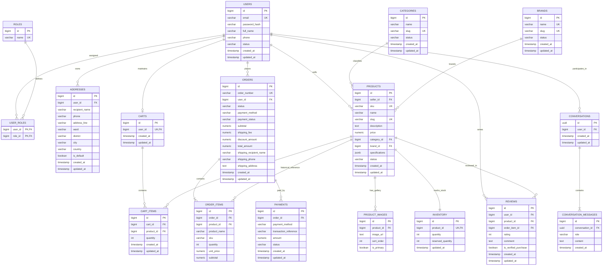

# Entity Relationship Diagram (ERD)

## 1. Overview

This document presents the Entity-Relationship Diagram (ERD) for the **AI Tech Marketplace** PostgreSQL transactional database, reflecting the relational schema defined in [database/schema.md](../database/schema.md).

---

## 2. Relational Model Diagram

---

## 3. Entity Classification & Cardinalities

| Entity Group | Entities | Cardinality & Integrity Rules |
| --- | --- | --- |
| **Identity & Access** | `USERS`, `ROLES`, `USER_ROLES`, `ADDRESSES` | - Users have a Many-to-Many relationship with Roles via `USER_ROLES`. - A User has Zero-to-Many `ADDRESSES`; at most one address is marked `is_default`. |
| **Catalog & Products** | `CATEGORIES`, `BRANDS`, `PRODUCTS`, `PRODUCT_IMAGES` | - Each Product belongs to one Seller (`USERS`), one Category and optionally one Brand. - Flexible product specifications are indexed via PostgreSQL `JSONB`. - `PRODUCT_IMAGES` provides a 1-to-N sorted image gallery. |
| **Inventory** | `INVENTORY` | - One-to-One with `PRODUCTS`. Available quantity is derived: `quantity - reserved_quantity`. |
| **Cart & Ordering** | `CARTS`, `CART_ITEMS`, `ORDERS`, `ORDER_ITEMS`, `PAYMENTS` | - A customer has exactly one active `CARTS`. - Unique composite constraint on `(cart_id, product_id)`. - `ORDERS` and `ORDER_ITEMS` capture immutable historical snapshots of recipient contact, shipping address, and product unit prices at purchase time. - `PAYMENTS` tracks gateway transaction states linked 1-to-N with `ORDERS`. |
| **Reviews & Feedback** | `REVIEWS` | - Customers submit 1-to-N verified reviews for purchased `PRODUCTS` with 1-5 star ratings. |
| **AI Conversations** | `CONVERSATIONS`, `CONVERSATION_MESSAGES` | - AI chat history linked to `user_id` using UUID keys for stateless session tracking. Messages store conversational roles (`USER`, `ASSISTANT`, `SYSTEM`). |
