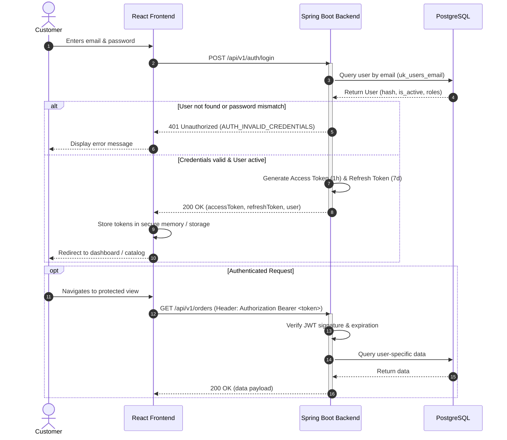
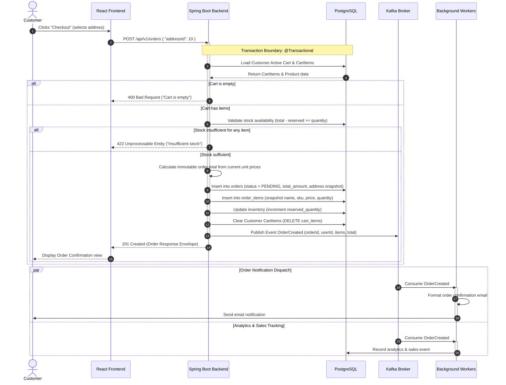
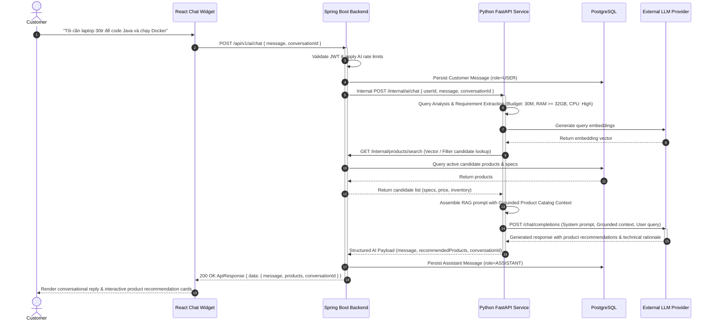

# Sequence Diagrams

## 1. Overview

This document specifies the dynamic runtime interactions between components, services, data stores, and external systems for the critical workflows of AI Tech Marketplace.

---

## 2. Authentication & JWT Lifecycle Flow

---

## 3. Shopping Cart & Order Checkout Flow

---

## 4. AI Shopping Assistant RAG & Recommendation Flow

---

## 5. Summary of Sequence Patterns

| Workflow | Communication Type | Core Guarantees |
| --- | --- | --- |
| **Authentication** | Synchronous REST | Stateless JWT, BCrypt password hashing, role enforcement. |
| **Checkout & Orders** | Synchronous REST + Asynchronous Kafka | Database ACID transaction, inventory reservation concurrency control, at-least-once event delivery. |
| **AI Shopping Chat** | Synchronous Multi-tier REST (React → Spring Boot → FastAPI → LLM) | Private AI security boundary, grounded catalog retrieval (no spec hallucination), graceful fallback on AI outage. |
