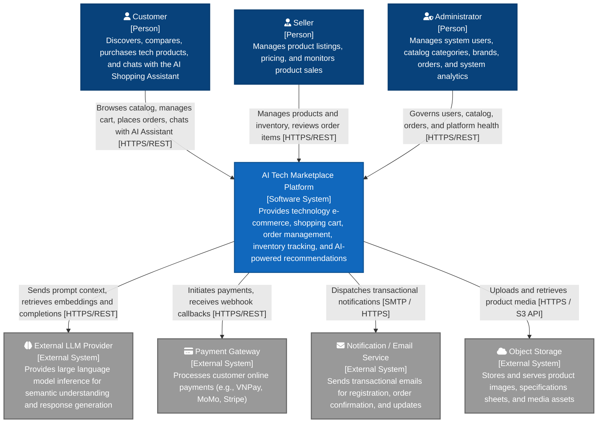

# System Context Diagram (C4 Model Level 1)

## 1. Overview

The System Context diagram provides a high-level view of the **AI Tech Marketplace** system, showing its boundaries, the human actors who interact with it, and external systems it integrates with.

---

## 2. Context Diagram

---

## 3. Actors

| Actor | Type | Description |
| --- | --- | --- |
| **Customer** | Person | End-user shopping for laptops, components, accessories, comparing products, and consulting the AI Shopping Assistant. |
| **Seller** | Person | Merchant managing their product catalog, pricing, and stock levels. |
| **Administrator** | Person | Internal platform operator governing accounts, categories, brands, orders, and reviewing analytics. |

---

## 4. Systems

| System | Classification | Description |
| --- | --- | --- |
| **AI Tech Marketplace** | Core System | The central platform encompassing React frontend, Spring Boot backend, Python AI service, PostgreSQL database, Redis cache, and Kafka messaging. |
| **External LLM Provider** | External System | Third-party AI model API (e.g., Gemini, OpenAI) utilized by the AI service for embeddings, RAG reasoning, and natural language chat. |
| **Payment Gateway** | External System | External payment service provider processing financial transactions and issuing webhook notifications. |
| **Notification / Email Service** | External System | Third-party transactional delivery service (e.g., SendGrid, Mailgun) handling automated notification dispatches. |
| **Object Storage** | External System | Cloud object storage (e.g., AWS S3, MinIO, Cloudinary) storing product gallery images and static attachments. |
